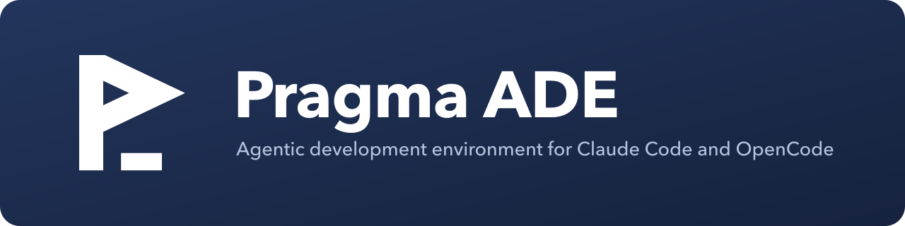

<p align="center">
  
</p>

<p align="center">
  An agentic development environment: run Claude Code and OpenCode agents side by side on git worktrees,
  review what they did, and send feedback straight back to them.
</p>

<p align="center">
  <a href="https://github.com/pragmataW/pragma-ade/releases/latest">Download</a> ·
  <a href="#install">Install</a> ·
  <a href="#build-from-source">Build from source</a> ·
  <a href="CHANGELOG.md">Changelog</a>
</p>

---

Pragma ADE is a desktop app (Electron) that puts everything you need around coding agents in one window: projects and
their worktrees on the left, agent sessions in the middle (as a terminal or a chat), and a right panel with a terminal,
a real VS Code editor, git changes and a browser. Comments you write on a diff line, an editor line or a browser element
go to the agent as one message.

It uses the agent CLIs already installed and signed in on your machine. There are no API keys, no accounts and no
telemetry.


## Features

- **Projects and worktrees** — create a worktree (and branch) per task, see each agent's status on its row.
- **Agents in terminal or chat** — Claude Code and OpenCode 2.x, plus any custom CLI agent. Edit the command and
  arguments of every profile (for example `--dangerously-skip-permissions`), pick a default, switch a session between
  chat and terminal and resume it.
- **Live agent status** — working, waiting for you, done or failed, on tabs, worktrees and the status bar, with
  notifications.
- **Review and comment** — full-file git diffs in a file tree; comment on lines or on browser elements and send the
  batch to the agent.
- **A real editor** — an embedded VSCodium workbench with VS Code extensions from Open VSX, language servers and
  linters.
- **Embedded browser** — per-worktree browser with an element picker (selector, DOM context, styles, screenshot).
- **Task board** — a local board whose cards start a worktree and an agent in one click.
- **`pragma` CLI and handoff** — agents can list and create worktrees, spawn agents, update tasks and hand work over to
  another agent.
- **Themes** — dark and light, four palettes, adjustable density, command palette and shortcuts.

<table>
  <tr>
    <td></td>
    <td></td>
  </tr>
  <tr>
    <td></td>
    <td></td>
  </tr>
</table>

## Requirements

- macOS 12 or later (Apple silicon or Intel), Linux x64 (glibc 2.31 or later), or Windows 10/11 x64.
- `git` on your `PATH` (Git for Windows on Windows).
- At least one agent CLI, installed and signed in: [Claude Code](https://docs.anthropic.com/en/docs/claude-code) and/or
  [OpenCode](https://opencode.ai) 2.x. Pragma ADE does not install them.
- Internet access the first time you open the Files tab (the VSCodium server is downloaded once and cached).

## Install

Release builds are on the [Releases page](https://github.com/pragmataW/pragma-ade/releases). They are **not signed or
notarized**, so each OS asks you to confirm the first launch.

### macOS

With [Homebrew](https://brew.sh):

```sh
brew install --cask pragmataW/tap/pragma-ade
```

The cask picks the arm64 or x64 build and clears the quarantine flag after install.

Manual install: download `pragma-ade-0.9.0-mac-arm64.dmg` (Apple silicon) or `pragma-ade-0.9.0-mac-x64.dmg` (Intel),
open it and drag **Pragma ADE** to **Applications** (the `.zip` builds contain the same app). Because the app is
unsigned, macOS blocks the first launch. Either:

- right-click (or Control-click) **Pragma ADE** in Applications, choose **Open**, then **Open** again, or
- open **System Settings › Privacy & Security** and click **Open Anyway**, or
- clear the quarantine flag in Terminal:

  ```sh
  xattr -dr com.apple.quarantine "/Applications/Pragma ADE.app"
  ```

If macOS says the app "is damaged and can't be opened", that is the quarantine flag: run the `xattr` command above.

### Linux (x64)

Debian, Ubuntu and derivatives — install the `.deb` (adds a menu entry and the `pragma-ade` command):

```sh
sudo apt install ./pragma-ade-0.9.0-linux-amd64.deb
# or: sudo dpkg -i pragma-ade-0.9.0-linux-amd64.deb && sudo apt-get install -f
```

Any distribution — run the AppImage:

```sh
chmod +x pragma-ade-0.9.0-linux-x86_64.AppImage
./pragma-ade-0.9.0-linux-x86_64.AppImage
```

AppImages need FUSE 2 (`libfuse2`, called `libfuse2t64` on Ubuntu 24.04). On Ubuntu 24.04 and later, AppArmor blocks
the Chromium sandbox of AppImages; prefer the `.deb` there.

### Windows (x64)

Download `pragma-ade-0.9.0-win-x64-setup.exe` and run it, or unzip `pragma-ade-0.9.0-win-x64.zip` anywhere and start
`Pragma ADE.exe`. The builds are unsigned, so SmartScreen shows "Windows protected your PC": click **More info ›
Run anyway**. Windows builds are less tested than macOS ones.

## Build from source

Requirements: Node.js 22.18 or later, [pnpm](https://pnpm.io) 11 (`corepack enable`), git, and the C/C++ toolchain
for native modules (Xcode Command Line Tools on macOS, `build-essential` and `python3` on Linux).

```sh
git clone https://github.com/pragmataW/pragma-ade.git
cd pragma-ade
pnpm install
pnpm dev            # run the app in development mode
```

Packages (unsigned) are built on a Mac:

```sh
pnpm package:mac    # dmg + zip for darwin-arm64 and darwin-x64
pnpm package:linux  # AppImage + deb for linux-x64 (compiles node-pty in Docker)
pnpm package:win    # NSIS setup + zip for win32-x64
pnpm package:all    # everything, with a native-module audit and a smoke test
```

Outputs go to `dist/`. See [docs/build.md](docs/build.md) for prerequisites (Docker for Linux, Rosetta for the x64
smoke test), caches and troubleshooting.

## Development

| Command | What it does |
|---|---|
| `pnpm dev` | run the app with hot reload |
| `pnpm lint` | Biome, duplicate-code check, literal check and architecture tests |
| `pnpm typecheck` | TypeScript for the main, preload and renderer code |
| `pnpm test` | unit and component tests (Vitest) |
| `pnpm e2e` | end-to-end tests against a fresh build (Playwright + Electron) |
| `pnpm gen` | regenerate the module registry |
| `pnpm icons` | regenerate the app icons from `assets/logo/*.svg` (needs `librsvg` and `imagemagick`) |

Pragma ADE is a thin Electron shell plus modules (`modules/<id>`) and agent providers (`providers/<id>`) written against
the `@pragma/sdk` package. Adding a feature means adding a folder. Start with:

- [docs/modules.md](docs/modules.md) — how to write a module or provider.
- [docs/phases/CONVENTIONS.md](docs/phases/CONVENTIONS.md) — the architecture contract.
- [docs/design/ui-notes.md](docs/design/ui-notes.md) — UI tokens, layout and components.
- [AGENTS.md](AGENTS.md) — rules for coding agents working on this repository.

The design spec, phase plans and phase reports under `docs/` record how the app was built. Some of them are in Turkish.

## License

[MIT](LICENSE) © 2026 pragmataW. Third-party code and assets are listed in
[THIRD_PARTY_NOTICES.md](THIRD_PARTY_NOTICES.md). Claude and OpenCode names and marks belong to their owners;
Pragma ADE is not affiliated with Anthropic or the OpenCode authors.
